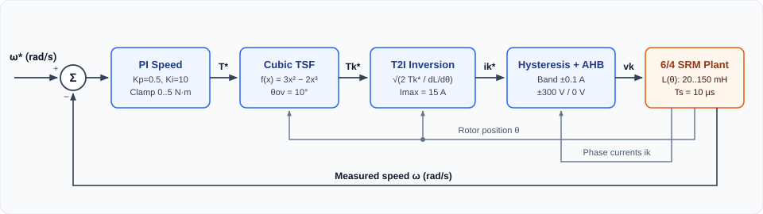
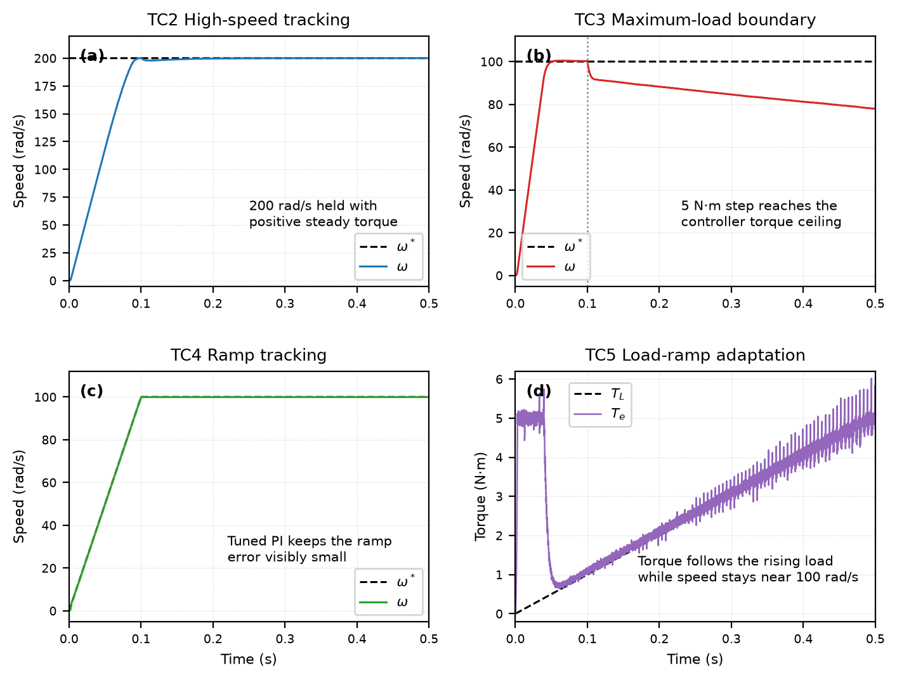
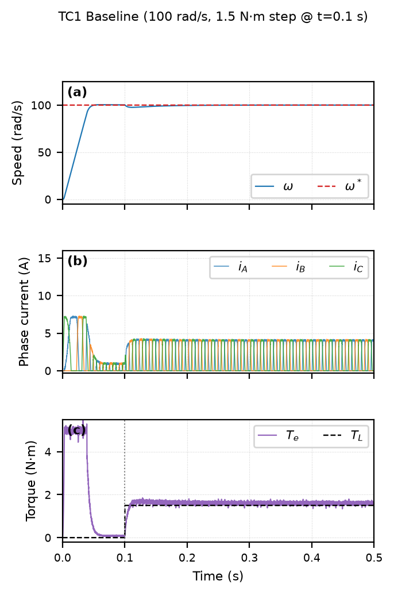
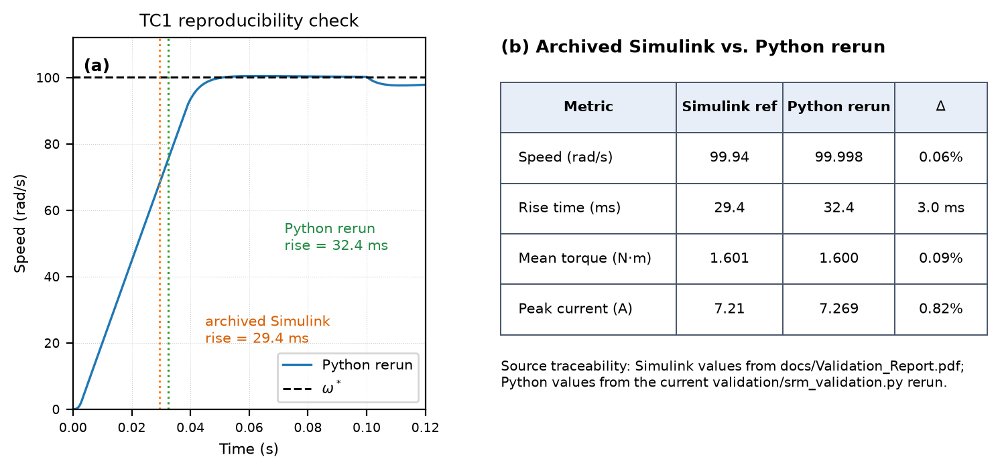

# SRM Speed and Torque Control

We built a cascaded speed and torque control system for a three-phase 6/4 switched reluctance motor (SRM) with cubic torque sharing in MATLAB/Simulink, and verified reproducibility with an independent Python solver.

[](https://github.com/andrew-abdelmalak/srm-speed-torque-control/actions/workflows/ci.yml)
[](https://github.com/andrew-abdelmalak/srm-speed-torque-control/actions/workflows/paper.yml)
[](LICENSE)

Read the [IEEE conference paper (PDF)](docs/SRM_Speed_Torque_Control_Paper.pdf), inspect the [LaTeX source](paper/main.tex), or run the [Python validation mirror](validation/srm_validation.py).

## How the drive works

We structured the controller as a four-layer cascade sampled at $T_s = 10\ \mu\text{s}$ (100 kHz):

<picture>
  <source media="(prefers-color-scheme: dark)" srcset="docs/diagrams/cascade-architecture-dark.svg">
  <source media="(prefers-color-scheme: light)" srcset="docs/diagrams/cascade-architecture.svg">
  
</picture>

1. **PI speed regulator:** Outputs total torque demand $T^*$ with conditional anti-windup clamping at $T_{\max} = 5.0\ \text{N}\cdot\text{m}$.
2. **Cubic torque sharing function (TSF):** Splits $T^*$ across active phases using $f(x) = 3x^2 - 2x^3$ over a $10^\circ$ overlap window. Because $f'(0) = f'(1) = 0$, incoming and outgoing phase-torque references start and finish with zero slope, avoiding the reference step that a linear TSF injects into the current loop at commutation edges.
3. **Torque-to-current (T2I) inversion:** Maps each phase torque command to $i_k^* = \sqrt{2 T_k^* / (dL_k / d\theta)}$ where $dL_k / d\theta > 0$, clamped at $I_{\max} = 15\ \text{A}$.
4. **Hysteresis current loop and asymmetric half-bridge (AHB):** Switches $+300\ \text{V}$, $0\ \text{V}$, or $-300\ \text{V}$ within a $\pm 0.1\ \text{A}$ band to magnetize, freewheel, or demagnetize each phase before $dL/d\theta$ turns negative.

<p align="center">
  
</p>

## Quick start

### Python simulation and test suite

Requires Python 3.11 or later and [`uv`](https://docs.astral.sh/uv/). Run from the repository root:

```bash
uv sync --locked --all-groups
uv run pytest -v
uv run python validation/srm_validation.py --all
```

Running `--all` executes all five test cases (TC1 to TC5) and regenerates the individual plots under `results/` plus both composite paper figures under `paper/`. To run a single test case and print its summary table:

```bash
uv run python validation/srm_validation.py --tc 1
```

### MATLAB, Octave, and Simulink

Validate the shared machine parameters and 1,000-point inductance lookup table without a MATLAB license using GNU Octave:

```bash
octave-cli --no-gui --eval "run('src/SRM_params.m'); disp(length(theta_vec));"
```

In MATLAB/Simulink R2024a or later:

```matlab
run('src/SRM_params.m')
open('src/SRM_Project.slx')
out = sim('SRM_Project')
run('src/SRM_plots.m')
```

### Paper PDF

Compile `paper/main.tex` using TeX Live 2025:

```bash
docker run --rm --network=none -u "$(id -u):$(id -g)" -v "$PWD:/work" -w /work/paper \
  texlive/texlive:TL2025-historic@sha256:7056390eac37715fd3e01875037ceb4016cb17d44c611f7bbbfa7a012007979f \
  latexmk -pdf -no-shell-escape -interaction=nonstopmode -halt-on-error main.tex
```

## Machine and controller parameters

All constants are defined in [`src/SRM_params.m`](src/SRM_params.m) and mirrored in [`validation/srm_validation.py`](validation/srm_validation.py) (enforced by `tests/test_srm_validation.py`):

| Parameter | Symbol | Value |
|---|---|---|
| Stator / rotor poles | $N_s / N_r$ | 6 / 4 (3 phases, $\tau = 90^\circ$) |
| Phase resistance | $R_s$ | $1.0\ \Omega$ |
| Unaligned / aligned inductance | $L_{\min}, L_{\max}$ | $20\ \text{mH},\ 150\ \text{mH}$ |
| Inductance breakpoints | $\theta_{\text{on}}, \theta_{\text{off}}, \theta_a, \theta_u$ | $0^\circ,\ 38^\circ,\ 43^\circ,\ 81^\circ$ |
| Inductance LUT resolution | $N_L$ | 1,000 points (MATLAB), 2,000 points (Python) |
| Rotor inertia and damping | $J, B$ | $0.002\ \text{kg}\cdot\text{m}^2,\ 0.001\ \text{N}\cdot\text{m}\cdot\text{s/rad}$ |
| DC-link voltage / current limit | $V_{dc}, I_{\max}$ | $300\ \text{V},\ 15\ \text{A}$ |
| Hysteresis half-band | $\Delta i$ | $0.1\ \text{A}$ |
| Speed PI gains (nominal / TC4 ramp) | $K_p, K_i$ | $0.5, 10\ \text{s}^{-1}$ ($K_p = 15$ for TC4) |
| Torque clamp | $T_{\max}$ | $5.0\ \text{N}\cdot\text{m}$ |
| Fixed step / simulation window | $T_s, T_{\text{sim}}$ | $10\ \mu\text{s},\ 0.5\ \text{s}$ (50,000 steps) |

## Operating envelope and reproducibility

| Case | Scenario | Measured Python rerun result |
|---|---|---|
| TC1 | $100\ \text{rad/s}$ step, $1.5\ \text{N}\cdot\text{m}$ load at $0.1\ \text{s}$ | Settles at $99.998\ \text{rad/s}$, $32.4\ \text{ms}$ rise time, $1.600\ \text{N}\cdot\text{m}$ mean torque, $7.269\ \text{A}$ peak current |
| TC2 | $200\ \text{rad/s}$ step, $1.5\ \text{N}\cdot\text{m}$ load at $0.1\ \text{s}$ | Settles at $199.999\ \text{rad/s}$; steady-state torque stays positive ($1.37$ to $2.11\ \text{N}\cdot\text{m}$) |
| TC3 | $100\ \text{rad/s}$ step, $5.0\ \text{N}\cdot\text{m}$ load at $0.1\ \text{s}$ | Reaches $5.014\ \text{N}\cdot\text{m}$ torque clamp ceiling and settles stably at $79.615\ \text{rad/s}$ |
| TC4 | $0 \to 100\ \text{rad/s}$ ramp in $0.1\ \text{s}$ ($K_p = 15$) | Ramp RMSE $0.214\ \text{rad/s}$, maximum absolute ramp error $1.252\ \text{rad/s}$ |
| TC5 | $100\ \text{rad/s}$ with $0 \to 5\ \text{N}\cdot\text{m}$ load ramp | Mean steady-state speed $98.995\ \text{rad/s}$; post-startup peak current scales monotonically with load |

<p align="center">
  
</p>

Comparing the Python forward-Euler mirror against the archived Simulink `ode4` metrics in [`docs/Validation_Report.pdf`](docs/Validation_Report.pdf) for TC1:

| Metric | Archived Simulink (`ode4`) | Python rerun (forward Euler) | Difference |
|---|---|---|---|
| Steady-state speed | $99.94\ \text{rad/s}$ | $99.998\ \text{rad/s}$ | $0.06\%$ |
| 10 to 90% rise time | $29.4\ \text{ms}$ | $32.4\ \text{ms}$ | $3.0\ \text{ms}$ |
| Mean steady-state torque | $1.601\ \text{N}\cdot\text{m}$ | $1.600\ \text{N}\cdot\text{m}$ | $0.09\%$ |
| Peak phase current | $7.21\ \text{A}$ | $7.269\ \text{A}$ | $0.82\%$ |

<p align="center">
  
</p>

## Validation scope and limitations

- **Simulation only:** We validated this drive in simulation (`MATLAB/Simulink` and Python) without a physical SRM or inverter test bench.
- **Archived Simulink artifacts:** `src/SRM_Project.slx` was last saved in an intermediate `0.2 s` test configuration and raw `.mat` time-series exports were not archived. All reproducible waveform plots come from `validation/srm_validation.py`, while Simulink comparison values come from `docs/Validation_Report.pdf`.
- **Linear magnetic model:** Inductance $L(\theta)$ is piecewise linear and independent of phase current, so magnetic saturation is not modeled.
- **Fixed firing angles:** Turn-on ($\theta_{\text{on}} = 0^\circ$) and turn-off ($\theta_{\text{off}} = 38^\circ$) angles are fixed rather than scheduled with speed.

## Repository layout

```text
.
|-- src/          MATLAB parameter script (SRM_params.m), plotting script, and Simulink model
|-- validation/   Independent Python forward-Euler simulation and figure generator
|-- tests/        Unit, physics-invariant, parameter-parity, and regression tests
|-- results/      Generated TC1-TC5 waveform figures (.pdf and .png)
|-- paper/        IEEEtran LaTeX manuscript, BibTeX references, and composite paper figures
|-- docs/         Compiled paper PDF, archived course reports, diagrams, and social preview
|-- pyproject.toml
`-- uv.lock
```

## Authors and acknowledgments

**MCTR 908 Electric Drives, German University in Cairo, Spring 2026**

| Name | Contributions |
|---|---|
| Ahmed Mostafa | Simulink model, machine parameters, initial figures |
| [Andrew Abdelmalak](https://github.com/andrew-abdelmalak) | Python validation mirror, test suite, IEEE paper, repository maintenance |
| Adham Bassem | Converter design, test-case definitions |
| Ahmed Mansour | TSF analysis, milestone reports, presentation |

We thank **Dr. Walid Atef Omran** (Associate Professor, Department of Mechatronics Engineering, German University in Cairo) for supervising this project.

## Contributing, citation, and license

See [CONTRIBUTING.md](CONTRIBUTING.md), our [security policy](.github/SECURITY.md), and [CITATION.cff](CITATION.cff). Released under the [MIT License](LICENSE).
